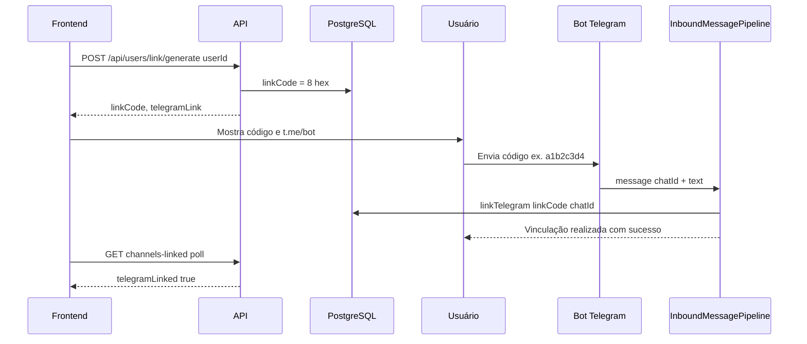

# Criação de usuário e vinculação de conta

Guia de integração da API **Jardim das Conquistas** para cadastro web, autenticação JWT e vínculo com **Telegram** ou **WhatsApp**. Documentação interativa complementar: Swagger em `/api/docs`.

Após o vínculo, o comportamento nos canais segue [CHANNEL_PARITY.md](./CHANNEL_PARITY.md).

---

## 1. Visão geral

### Jornada do usuário

1. **Cadastro** no front (`POST /api/users`).
2. **Login** (`POST /api/users/login`) → recebe JWT e `userId`.
3. **Tela de vínculo** (se Telegram/WhatsApp ainda não estiverem associados).
4. **Gerar código** (`POST /api/users/link/generate`) e enviar o código no bot/canal.
5. O backend associa o chat/telefone ao usuário; lembretes e conversas passam a usar o canal vinculado.

### Modelo `User` (resumo)

| Campo | Descrição |
| --- | --- |
| `id` | UUID (chave primária) |
| `name`, `email`, `password` | Credenciais (senha hasheada com bcrypt) |
| `timezone` | Fuso IANA (default `America/Fortaleza`) |
| `currentWorldId` | Mundo inicial; na criação o backend define `mundo2` |
| `linkCode` | Código temporário de 8 caracteres hex para vincular (único, nullable) |
| `telegramId` | `chat.id` do Telegram após vincular (único, nullable) |
| `whatsappId` | Telefone só dígitos com DDI (único, nullable) |
| `preferredChannel` | `TELEGRAM` ou `WHATSAPP` após vínculo/uso do canal |

Definição completa: `prisma/schema.prisma`.

---

## 2. Cadastro — `POST /api/users`

**Autenticação:** não exigida.

### Corpo (JSON)

| Campo | Obrigatório | Descrição |
| --- | --- | --- |
| `name` | sim | Nome (trim; máx. 80 caracteres) |
| `email` | sim | E-mail único |
| `password` | sim | Senha em texto (armazenada com bcrypt) |
| `timezone` | não | Fuso IANA, ex. `America/Fortaleza` |

### Timezone na requisição

O fuso pode vir no **body** (`timezone`) ou nos headers:

- `X-Timezone` (recomendado no front)
- `Timezone`

O header tem prioridade inferior ao body quando o body traz `timezone` preenchido. Ver `src/modules/shared/request-timezone.util.ts`.

**CORS:** o front em outro domínio deve poder enviar `X-Timezone`. O backend permite `Content-Type`, `Authorization`, `X-Timezone` e `Timezone` em `src/main.ts`.

### Regras de negócio

- Nome vazio ou só espaços → **400**.
- Nome com mais de 80 caracteres → **400**.
- `timezone` informado mas inválido (não IANA) → **400**.
- E-mail já cadastrado → **409** (`Já existe um registro com esses dados` via Prisma P2002).

### Resposta de sucesso (201)

Retorna o objeto `User` criado (inclui `id`). A senha não deve ser exibida no front; o Prisma devolve o hash — trate apenas `id`, `name`, `email`, `timezone`, etc.

### Exemplo

```http
POST /api/users HTTP/1.1
Host: api.example.com
Content-Type: application/json
X-Timezone: America/Fortaleza

{
  "name": "Maria Silva",
  "email": "maria@example.com",
  "password": "SenhaSegura123"
}
```

```javascript
await fetch('https://api.example.com/api/users', {
  method: 'POST',
  headers: {
    'Content-Type': 'application/json',
    'X-Timezone': Intl.DateTimeFormat().resolvedOptions().timeZone,
  },
  body: JSON.stringify({
    name: 'Maria Silva',
    email: 'maria@example.com',
    password: 'SenhaSegura123',
  }),
});
```

---

## 3. Login — `POST /api/users/login`

**Autenticação:** não exigida.

### Corpo

| Campo | Obrigatório |
| --- | --- |
| `email` | sim |
| `password` | sim |
| `timezone` | não |

Se `timezone` (body ou header) for válido, o backend atualiza o fuso do usuário no login.

### Resposta (200)

```json
{
  "message": "Login ok",
  "userId": "550e8400-e29b-41d4-a716-446655440000",
  "token": "<JWT>",
  "timezone": "America/Fortaleza"
}
```

- **JWT:** assinado com `JWT_SECRET`, expiração **7 dias** (`src/auth/auth.guard.ts`).
- **Payload:** `userId`, `email`.

### Uso no front

Em rotas protegidas com `AuthGuard`:

```http
Authorization: Bearer <token>
```

Exemplos: `GET /api/users/me`, `PATCH /api/users/me`, metas, dashboard, etc.

---

## 4. Verificar vínculo

Usado para decidir se mostra a tela “Vincule seu Telegram”.

### `GET /api/users/:id/telegram-linked`

**Autenticação:** não exigida hoje.

```json
{ "linked": true }
```

### `GET /api/users/:id/channels-linked`

**Autenticação:** não exigida hoje.

```json
{
  "telegramLinked": true,
  "whatsappLinked": false,
  "preferredChannel": "TELEGRAM"
}
```

**Limitação atual:** qualquer cliente que conheça o UUID pode consultar o status. Integração recomendada no front: usar o `userId` retornado no login do próprio usuário. Melhoria futura sugerida: rotas `GET /api/users/me/channels-linked` com JWT.

---

## 5. Gerar código de vínculo — `POST /api/users/link/generate`

**Autenticação:** não exigida hoje (ver [Segurança](#11-segurança)).

### Corpo

```json
{
  "userId": "550e8400-e29b-41d4-a716-446655440000"
}
```

O `userId` deve ser o do **usuário logado** (resposta do login), nunca um ID fixo no código do front.

### Comportamento

1. Gera `linkCode` = 8 caracteres hex (`randomBytes(4).toString('hex')`).
2. Grava em `User.linkCode` (substitui código anterior).
3. Retorna o código e metadados dos canais.

### Resposta (201)

```json
{
  "linkCode": "a1b2c3d4",
  "botUsername": "JardimDasConquistas_bot",
  "botName": "Jardim das Conquistas",
  "botInfo": { "id": 123, "username": "...", "first_name": "..." },
  "telegramLink": "https://t.me/JardimDasConquistas_bot",
  "whatsappNumber": "5511999999999",
  "whatsappInstructions": "Envie o código a1b2c3d4 no WhatsApp para 5511999999999 para vincular sua conta."
}
```

- **Bot Telegram:** `@` vem de `getMe()` na inicialização do bot ou fallback `TELEGRAM_BOT_USERNAME`. Não é um “usuário estático” do app — é a configuração do bot no Telegram/ambiente.
- **WhatsApp:** texto usa `WHATSAPP_NUMBER` quando definido.

---

## 6. Fluxo Telegram (recomendado)

O usuário **não** chama `POST /api/users/link/telegram` no fluxo normal. Ele envia o **código como mensagem de texto** para o bot; o backend faz o vínculo no polling.



### Validação do código

No pipeline inbound, o texto deve casar com:

```regex
^[a-f0-9]{8}$
```

(case insensitive na prática; envie exatamente os 8 caracteres devolvidos em `linkCode`).

### Mensagens do bot (usuário ainda não vinculado)

| Situação | Mensagem (resumo) |
| --- | --- |
| Texto que não é código hex | Pede para enviar o código gerado no app/web |
| Código válido | Confirmação com nome do usuário |
| Código inválido / expirado | Pede para gerar novo código no app/web |

### Efeito no banco

- `telegramId` = `String(chat.id)` do Telegram.
- `linkCode` = `null`.
- `preferredChannel` = `TELEGRAM`.

### Vínculo manual (API)

`POST /api/users/link/telegram` com `{ "linkCode", "telegramId" }` existe para testes ou integrações especiais. O fluxo de produção é via mensagem no bot.

---

## 7. Fluxo WhatsApp

Mesma ideia do Telegram:

1. Gerar código no app.
2. Enviar **somente o código** (8 hex) em mensagem para o número Evolution/WhatsApp configurado.
3. O webhook Evolution → `InboundMessagePipeline` → `linkWhatsApp(linkCode, whatsappId)`.
4. `whatsappId` = dígitos do telefone (DDI, sem `+`).

Também existe `POST /api/users/link/whatsapp` para vínculo via API.

---

## 8. Informações do bot — `GET /api/users/link/bot-info`

**Autenticação:** não exigida.

Retorna `botUsername`, `botName`, `botInfo`, `telegramLink`, `whatsappNumber` **sem** gerar novo código — útil para telas de ajuda antes do usuário clicar em “Gerar código”.

---

## 9. Variáveis de ambiente

| Variável | Papel |
| --- | --- |
| `DATABASE_URL` | Persistência de usuários e códigos |
| `JWT_SECRET` | Login (mín. 16 caracteres) |
| `CORS_ALLOWED_ORIGINS` | Origens do front (cadastro/login com headers customizados) |
| `TELEGRAM_BOT_TOKEN` | Polling do bot; obrigatório para vínculo Telegram |
| `TELEGRAM_BOT_USERNAME` | Fallback do @ na UI se `getMe()` ainda não completou |
| `WHATSAPP_NUMBER` | Instruções na resposta de `generate` |
| `EVOLUTION_BASE_URL`, `EVOLUTION_API_KEY` | WhatsApp pós-vínculo (mensagens, lembretes) |
| `PUBLIC_BASE_URL` | Webhooks Evolution (não é específico do vínculo, mas do canal) |

Sem `TELEGRAM_BOT_TOKEN`, o módulo Telegram falha na inicialização e o vínculo por bot não funciona.

---

## 10. Erros comuns (troubleshooting)

| Sintoma | Causa provável |
| --- | --- |
| CORS em `me`, `channels-linked`, `generate` | Front com `credentials: "include"` mas API com `credentials: false` — usar `credentials: "omit"` ([CORS_FRONTEND.md](./CORS_FRONTEND.md)); incluir `http://localhost:8080` em `CORS_ALLOWED_ORIGINS` se dev local chama API prod |
| CORS só no cadastro | Preflight bloqueava `X-Timezone`; conferir `allowedHeaders` no servidor e `CORS_ALLOWED_ORIGINS` |
| “CORS” com API fora | `GET /health` retorna 503 — proxy sem headers CORS; ver [PRODUCTION_TROUBLESHOOTING.md](./PRODUCTION_TROUBLESHOOTING.md) |
| `409` no cadastro | E-mail já existe |
| Bot: “Código inválido” | Código antigo (novo generate invalidou), typo, ou banco/ambiente diferente (prod vs local) |
| `409` / erro de unique no vínculo | `telegramId` ou `whatsappId` já usado por outra conta |
| Bot não responde | Token inválido, bot parado, ou instância não é a mesma do `TELEGRAM_BOT_TOKEN` do ambiente |
| Front sempre vincula “outra” conta | `userId` fixo no `POST .../link/generate` — usar sempre o do login |

---

## 11. Segurança

| Rota | Situação |
| --- | --- |
| `POST /api/users/link/generate` | Aceita qualquer `userId` no body **sem** JWT; quem souber um UUID pode gerar código para aquela conta |
| `GET .../:id/telegram-linked`, `channels-linked` | Públicas por UUID |

**Recomendação de integração (front):** enviar apenas o `userId` da sessão atual; não commitar IDs de teste.

**Melhoria futura (backend):** proteger `generate` com `AuthGuard` e usar `req.user.userId`; expor status de vínculo em `GET /api/users/me/...`.

---

## 12. Checklist integração frontend

1. `POST /api/users` → obter `id` **ou** ir direto para login após cadastro.
2. `POST /api/users/login` → guardar `token` e `userId`.
3. `GET /api/users/:userId/channels-linked` → se `telegramLinked` / `whatsappLinked` forem `false`, mostrar tela de vínculo.
4. `POST /api/users/link/generate` com `{ "userId": "<do login>" }`.
5. Exibir `linkCode`, `telegramLink` e instruções WhatsApp; abrir bot em nova aba se desejado.
6. **Polling** (ex. a cada 3–5 s): `GET /api/users/:userId/channels-linked` até o canal desejado ficar `true`.
7. Nas demais chamadas: `Authorization: Bearer <token>`, `X-Timezone` quando aplicável, e **`credentials: "omit"`** em todo `fetch` cross-origin (ver [CORS_FRONTEND.md](./CORS_FRONTEND.md)).

---

## 13. Referências de código

| Arquivo | Responsabilidade |
| --- | --- |
| `src/modules/users/user.controller.ts` | Cadastro, login, verificação de vínculo |
| `src/modules/users/user.service.ts` | Regras de criação, bcrypt, timezone |
| `src/modules/users/user-link.controller.ts` | Generate, bot-info, endpoints manuais de link |
| `src/modules/users/user-link.service.ts` | `linkCode`, `linkTelegram`, `linkWhatsApp` |
| `src/modules/inbound/inbound-message-pipeline.ts` | Recebe código no Telegram/WhatsApp |
| `src/modules/telegram/telegram.service.ts` | Polling, username do bot |
| `src/auth/auth.guard.ts` | JWT |
| `src/filters/prisma-exception.filter.ts` | 409 e-mail duplicado |
| `prisma/schema.prisma` | Modelo `User` |

---

## Apêndice: exemplos de respostas de erro

**400 — nome inválido**

```json
{
  "statusCode": 400,
  "message": "O nome não pode ficar vazio."
}
```

**401 — login**

```json
{
  "statusCode": 401,
  "message": "Senha incorreta"
}
```

**409 — e-mail duplicado**

```json
{
  "statusCode": 409,
  "error": "CONFLICT",
  "message": "Já existe um registro com esses dados",
  "prismaCode": "P2002"
}
```